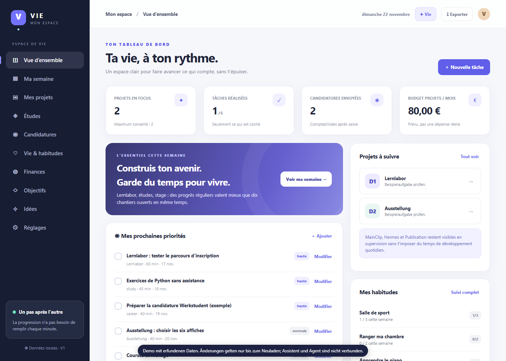

# Vie – lokaler Alltags- und Projektplaner

Aufgaben, Wochenplanung, Projekte und Budgetübersichten bleiben lokal. Der optionale lokale Assistent trennt Lesen, Zustimmungen und bestätigte Änderungen. Die öffentliche Fassung startet ohne persönliche Planungsdaten.

**Technik:** JavaScript, Node.js, lokale Speicherung, Agent SDK.

[Interaktive Demo](https://jorxas.github.io/Vie/) · [Portfolio](https://jorxas.github.io/Portfolio/) · [Architektur](ARCHITEKTUR.md) · [Prüfstatus](PRUEFUNG.md)

## Ausprobieren

Die Demo ist die echte Oberfläche von Vie (`index.html`, `app.js`, `core.js`) mit erfundenen Beispieldaten aus `demo/demo-start.js`: Aufgaben der Woche, drei Bewerbungen, Gewohnheiten und zwei Ausgaben. Alles läuft im Browser und im Arbeitsspeicher; beim Neuladen beginnt die Demo neu. Der Assistent und der lokale Agent brauchen den Node-Server und sind in der Demo nicht verbunden.

## Demo lokal öffnen

~~~sh
node tools/demo-bauen.mjs
python -m http.server 8080 --bind 127.0.0.1 --directory dist
~~~

Danach http://127.0.0.1:8080 öffnen. Die Demo benötigt weder Konten noch einen Server. Die Browserprüfung (`node tools/browser-pruefen.cjs`, mit puppeteer-core und installiertem Chrome oder Edge) baut nichts selbst, sie prüft das Ergebnis von `tools/demo-bauen.mjs`.

## Lokal prüfen

~~~sh
node test_core.cjs
node test_hardening.cjs
~~~

Die genauen geprüften Befehle und Grenzen stehen in [PRUEFUNG.md](PRUEFUNG.md). Produktive Schlüssel, persönliche Daten und Modelle gehören ausschließlich in die lokale Installation.

## Herkunft

Dies ist eine für die Veröffentlichung geprüfte Ableitung eines bestehenden lokalen Projekts. [HERKUNFT.md](HERKUNFT.md) trennt den ursprünglichen Entwicklungsstand von den jetzt ausgeführten Veröffentlichungsarbeiten. Die ursprünglichen Oberflächen und technischen Bezeichner sind teilweise französisch oder englisch. Neue Präsentation und Dokumentation sind deutsch.

## Rechte und Abhängigkeiten

Für eigenen Quellcode wird hier keine zusätzliche Nutzungslizenz eingeräumt. Die Lizenzen der genannten Bibliotheken und Modelle gelten unabhängig davon. Fremde Modelle, Stimmen, Medien und Zugangsdaten werden nicht mitgeliefert. Siehe [DRITTANBIETER.md](DRITTANBIETER.md).

## Lokale Anwendung

Für die vollständige lokale Anwendung: `npm ci`, anschließend `npm start`. Der Node-Server begrenzt die ausgelieferten Dateien; den gesamten Projektordner nicht als öffentlichen statischen Webserver freigeben. Der optionale Assistent benötigt eine autorisierte lokale Agent-Sitzung und bewusst erteilte Berechtigungen. Die statische Demo läuft unabhängig davon und verwendet keine Agent-Abhängigkeit.
